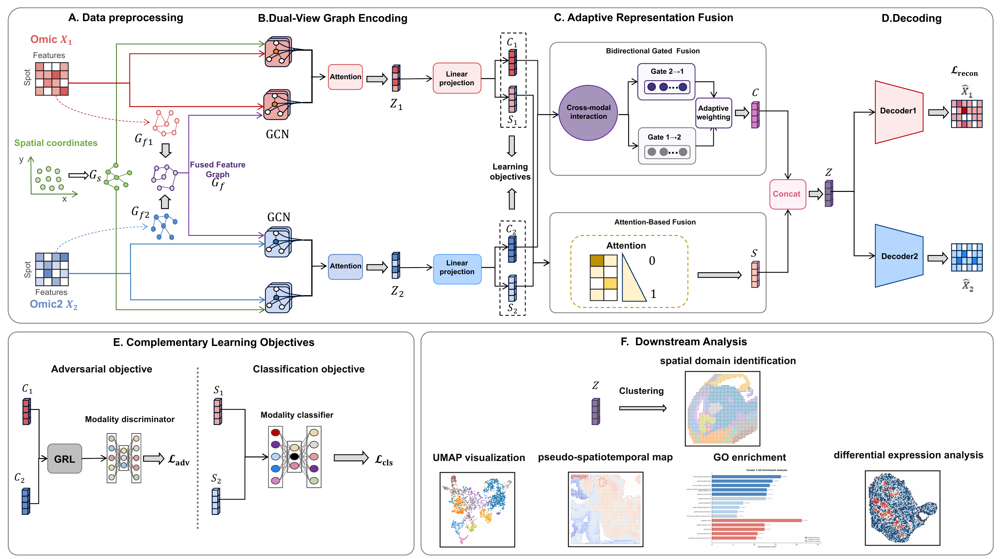

# SpaDVRL: Dual-View Representation Learning with Adaptive Fusion for Spatial Multi-Omics Integration

## Overview

SpaDVRL is a dual-view representation learning framework for spatial
multi-omics integration and spatial domain identification. It models physical
proximity and molecular similarity through a spatial graph and a fused feature
graph. The encoded modality representations are organized into two
complementary streams guided by adversarial and classification objectives.
Bidirectional gated interaction and attention-based fusion then combine these
streams into an integrated embedding for downstream clustering and
visualization.



## Repository structure

```text
SpaDVRL_GitHub/
|-- data/
|   |-- Simulate_data_RNA_Protein/
|   `-- README.md
|-- SpaDVRL/
|   |-- backbone.py
|   |-- datasets.py
|   |-- evaluation.py
|   |-- experiment.py
|   |-- model.py
|   |-- preprocess.py
|   `-- trainer.py
|-- scripts/
|   |-- run_simulation.py
|   |-- run_a1.py
|   `-- run_e155.py
|-- environment.yml
|-- framework.png
|-- requirements.txt
|-- LICENSE
`-- README.md
```

- `data/`: included simulated RNA--protein data and instructions for obtaining
  and arranging the real datasets.
- `SpaDVRL/`: core implementation of data preprocessing, graph construction,
  model architecture, training, clustering and evaluation.
- `scripts/`: executable workflows for the simulated RNA--protein, human lymph
  node A1 RNA--ADT and E15.5 mouse brain RNA--ATAC datasets.
- `environment.yml` and `requirements.txt`: software dependencies required to
  run the project.

## Installation

The reference environment uses Python 3.9, PyTorch, Scanpy and R `mclust`.

```bash
conda env create -f environment.yml
conda activate spadvrl
```

Run the scripts from the repository root so that Python can import the local
`SpaDVRL` package directly.

If an existing R installation is used, install `mclust` and ensure that it is
visible to `rpy2`.

## Data

The simulated RNA--protein benchmark generated for this study is included in
`data/Simulate_data_RNA_Protein`. The human lymph node A1, E15.5 MISAR-seq
mouse brain, E13.0 mouse embryo and Stereo-CITE-seq mouse thymus datasets are
publicly available from their original studies or data repositories. Download
and arrange the real datasets according to [data/README.md](data/README.md),
which provides the source links, accession numbers and expected file layout.

## Run the example workflows

Run commands from the repository root. The simulated dataset is already
included, whereas A1 and E15.5 must first be arranged as described in
[data/README.md](data/README.md).

```bash
python scripts/run_simulation.py --device cuda:0
python scripts/run_a1.py --device cuda:0
python scripts/run_e155.py --device cuda:0
```

Each script runs the complete SpaDVRL workflow using the corresponding
dataset-specific settings and generates spatial clustering and UMAP plots.
PNG and PDF figures are saved under `outputs/`, together with the learned
embedding, cluster labels, UMAP coordinates and evaluation metrics.

Custom data and output locations can be supplied when needed:

```bash
python scripts/run_a1.py \
  --data-dir /path/to/10x_human_lymph_node_A1 \
  --output-dir outputs/a1_Result \
  --device cuda:0
```

